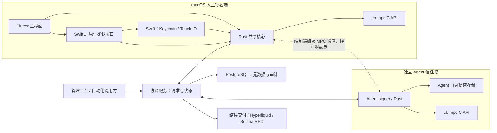
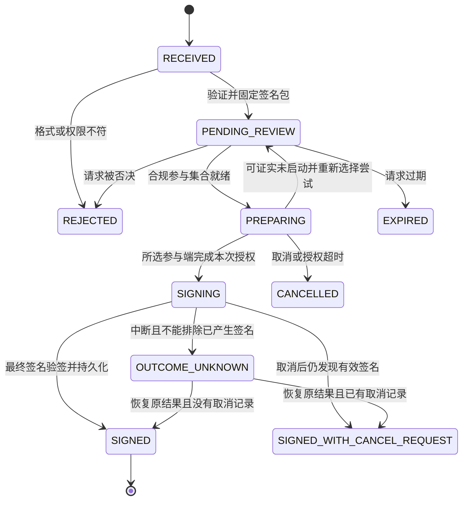
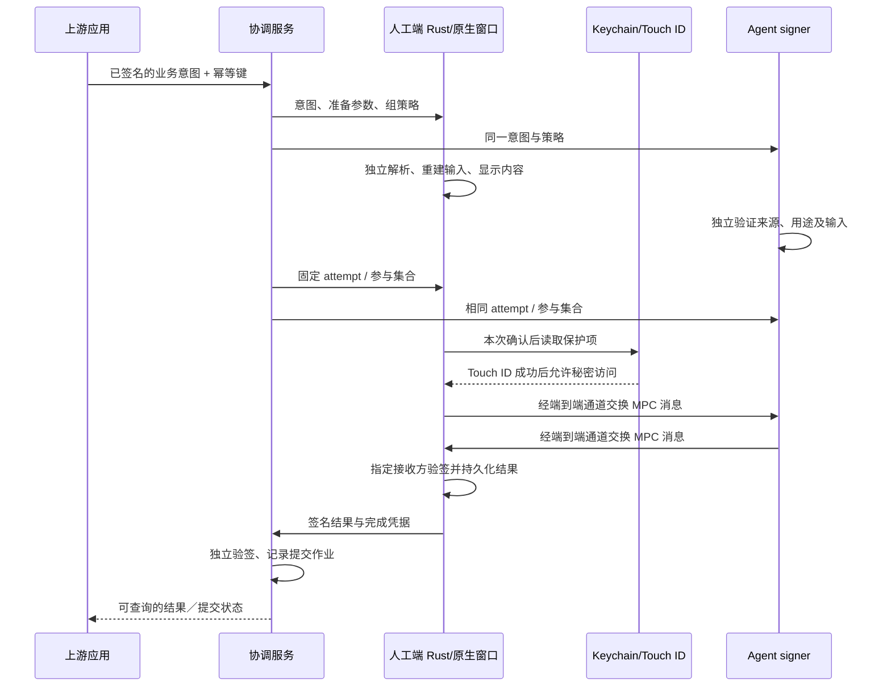

# keymux 详细技术设计

版本：0.1（设计稿）

日期：2026-11-11（Asia/Shanghai）

需求依据：[AGENTS.md](../AGENTS.md)

适用阶段：macOS 首期、后续多端扩展；尚无产品实现。

本文区分三种状态：**已确认需求**来自用户及 AGENTS.md；**设计基线**是本稿提出的实现选择；**待验证**表示必须通过原型、硬件或协议兼容测试后才能作为发布能力。本文不是已经完成的实现、测试或安全审计报告。

## 1. 目标、范围与验收边界

### 1.1 已确认需求

| 编号 | 需求 | 可观察的验收结果 |
| --- | --- | --- |
| R1 | 多客户端 MPC 签名，一期 macOS | 多个独立参与端共同完成签名，各端只使用自己的份额 |
| R2 | 使用 Coinbase cb-mpc | 密码协议通过固定版本的公共 API 调用，不自行实现门限算法 |
| R3 | 门限可按密钥组配置，`2 ≤ t ≤ n` | 合规子集成功，不足门限或重复参与方失败 |
| R4 | 支持纯人工及 Agent 与人工协同 | 人机组必须同时包含指定 Agent 和足够人工，不能只检查人数 |
| R5 | 人工使用 Keychain 保护的份额，触发 Touch ID | 未通过本次授权不能读取／解密份额，取消后不能继续签名 |
| R6 | 管理平台审批业务数据，输出 Ed25519 签名 | 平台能按固定协议验签、核验审批内容并拒绝重复执行 |
| R7 | Agent 与人工共同签 Hyperliquid 请求并提交交易 | Agent 仅持一份份额，独立不能完成所需签名；提交结果可追踪 |
| R8 | Solana 等链签名，参与规则按密钥组配置 | Solana 纯人工和人机组均可使用；各链规则分别验证 |
| R9 | 快速扩展到多端，采用 Flutter、SwiftUI、Rust、cb-mpc C API 的组合方向 | 通用 UI 与签名逻辑可复用，平台安全能力有独立适配边界 |

### 1.2 本稿的首期交付基线

- macOS Flutter 应用；SwiftUI 原生确认窗口；Swift 接入 Security / LocalAuthentication；Rust 负责共享逻辑，调用 cb-mpc C API。
- 一个协调服务进程、一套 PostgreSQL 数据库；一个独立的 Agent signer 进程。协调服务不兼任 MPC 参与方。
- 三类适配：`business.ed25519.v1`、`hyperliquid.order.v1`、`solana.transaction.v1`；同时定义受限的 Solana 链下消息签名扩展入口。
- 新建密钥组、签名、固定成员份额刷新，以及经验证的分散备份／恢复流程。生产启用前必须完成恢复演练。
- 先在测试环境打通全流程。真实业务和主网开放以第 18 节验收为准，不以“能够编译”代替可发布。

Hyperliquid 首个实现动作建议为 HyperCore 下单；撤单等动作按独立方法补充并验证。Solana 首个实现建议为 legacy/v0 交易及明确白名单内的指令；完整链下消息互操作、其他交易版本和其他链不宣称已支持。这里是交付顺序，不删除已确认的扩展需求。

### 1.3 首期不做的工作

不自研密码协议，不重构完整私钥进行正常签名，不提供任意字节盲签入口，不自动部署链上多签合约，不提前拆微服务或建设通用插件市场。Windows、iOS、Android 的本地 MPC 签名需要独立验证；Web 可作为请求／查询界面，首期不保存 MPC 份额。

## 2. 技术组合与替代方案

用户提出了 SwiftUI + Flutter + Rust + cb-mpc C API 的方向。以下职责分配是本稿建议，避免维护两套完整客户端界面。

| 层 | 设计基线 | 职责与边界 |
| --- | --- | --- |
| 通用客户端 UI | Flutter / Dart | 密钥组列表、待办、进度、历史和设置；不接收明文份额、DEK 或秘密 nonce |
| macOS 原生 UI | SwiftUI，经 AppKit 宿主展示 | 显示 Rust 生成的不可变签名意图，确认／拒绝，触发原生授权 |
| macOS 安全适配 | Swift + Security + LocalAuthentication | Keychain、Touch ID、设备身份密钥、平台生命周期 |
| 共享核心 | Rust | 请求验证、策略、业务／链编码、会话、验签、传输及 cb-mpc 安全包装 |
| 密码实现 | cb-mpc 公共 C API | DKG、访问结构、份额刷新、Ed25519 / ECDSA 门限协议 |
| 协调服务 | Rust 单体，PostgreSQL | 身份注册、请求、调度、密文中继、状态、审计和提交作业 |
| Agent signer | Rust 独立进程 | 持有 Agent 自身份额、验证请求和策略、参与 MPC；与协调服务独立权限 |

Flutter 主界面不嵌套成 SwiftUI 的另一套导航；macOS 宿主只增加一个原生确认窗口及安全桥。Flutter 调用 Rust 暴露的项目 C ABI，Swift 也调用同一个 ABI；不得在 Dart 层直接绑定 cb-mpc 的全部接口。平台事件通过类型化平台通道传递请求 ID、结果状态等非秘密数据。原生互操作能力依据 [Flutter FFI](https://docs.flutter.dev/interop/bind-native-code) 与[平台通道文档](https://docs.flutter.dev/platform-integration/platform-channels)，具体构建模板在原型中固定。

| 方案 | 优点 | 代价 | 本稿选择 |
| --- | --- | --- | --- |
| 全 SwiftUI + Rust | macOS 原生实现直接 | 非 Apple 平台需重写 UI | 不作为主线，保留为比较方案 |
| Flutter + SwiftUI 安全窗口 + Rust | 复用主界面，原生确认与系统授权衔接清楚 | 需要 Dart／Swift／Rust 边界验证 | 推荐基线，符合用户组合方向 |
| Flutter + 纯 Swift 安全桥 + Rust | 更少 UI 代码 | 确认页面全部由 Flutter 承担 | 更小的可行替代；若原生窗口没有实际收益，可后续选择 |

SwiftUI 本身不提供额外的密码学隔离。Flutter、Swift 与 Rust 默认处于同一进程；上述分层防止误传秘密、减少重复逻辑，不抵御整个客户端进程被攻陷。若威胁模型要求隔离恶意 UI 插件，需另行评估签名 helper / XPC，不在首期提前加入。

### 2.1 多端支持矩阵

| 平台 | UI 复用 | 原生安全适配 | MPC 核心状态 |
| --- | --- | --- | --- |
| macOS | Flutter 主 UI | SwiftUI、Keychain、Touch ID | 首期目标，Apple Silicon 优先验证；Intel 和最低系统版本待固定 |
| Linux | Flutter 可复用 | 需独立秘密存储方案 | cb-mpc 官方支持原生 Linux；Agent 首选部署候选 |
| iOS / Android | Flutter 可复用 | iOS 原生安全桥／Android Keystore 与生物识别 | cb-mpc 官方未列为支持目标，构建与安全特性验证后才能承诺 |
| Windows | Flutter 可复用 | 系统凭据保护和生物识别适配 | cb-mpc 移植待验证 |
| Web | 请求、查看、审批准备 UI 可复用部分逻辑 | 浏览器身份登录 | 首期不运行 cb-mpc、不持有份额 |

cb-mpc 的[平台声明](https://github.com/coinbase/cb-mpc/blob/v0.2.2/README.md#supported-runtime-and-deployment-environments)仅覆盖原生 64 位 macOS 和 Linux。Flutter 的[macOS 构建说明](https://docs.flutter.dev/platform-integration/macos/building)已提示 Intel 支持的弃用方向，因此不能只依据 cb-mpc 的 Intel 支持承诺整套应用长期兼容。

## 3. 领域模型

| 名称 | 定义 | 不应混淆为 |
| --- | --- | --- |
| 工作空间 Workspace | 一组共同管理应用、成员和密钥组的业务边界 | Git 仓库或设备用户目录 |
| 上游应用 Application | 被授权创建某些用途签名请求的管理平台或自动化系统 | MPC 参与方 |
| 参与方 Participant | 持有某个密钥组一个逻辑份额的人工或 Agent | 一个窗口、一次登录或份额副本 |
| 设备 Device | 运行签名端、拥有设备身份凭据的实体 | 人的业务身份；Touch ID 不返回组织成员身份 |
| 密钥组 KeyGroup | 一个聚合公钥及其算法、成员、访问结构、用途和版本 | 多个独立私钥拼接的签名集合 |
| 本地份额 KeyShare | cb-mpc 为该参与方产生的秘密 blob 及绑定元数据 | 最终签名或可上传给协调器的普通配置 |
| 审批决定 Approval | 对固定请求内容的同意或拒绝记录 | 已经产生签名，或永久解锁份额 |
| 签名尝试 SigningAttempt | 固定参与集合、输入和份额版本的一次 MPC 执行 | 可跨重启继续复用的任意任务 |
| 签名结果 SignatureResult | 对准确输入可独立验证的最终标准签名 | 链已接受交易的证明 |
| 提交 Submission | 将已签请求发送到目标系统并追踪结果 | 签名过程本身 |

一个人工可登记多台设备，但首期同一组同一参与方只允许一个活跃签名设备。换机是设备绑定与份额恢复操作，不能靠复制 blob 增加 n。一个组织成员注册多个逻辑身份的风险由成员治理控制，密码协议无法识别两台设备背后是否同一个人。

## 4. 系统结构与信任边界



图中的 Keychain → Rust 表示本地进程内、受控生命周期的秘密访问；该数据不能沿 Flutter 通道或网络 API 返回。人工之间也使用相同的 MPC 通道。

### 4.1 威胁模型

| 威胁 | 设计要求 | 明确的剩余边界 |
| --- | --- | --- |
| 协调服务被控制 | 不持份额；参与端独立验证意图、成员清单及策略；MPC 消息端到端保护 | 仍可阻断服务、隐藏状态、观察参与时间及业务元数据 |
| 少于合法签名集合的参与方被控制 | 协议验证与访问结构拒绝非法组合；不得在网络上汇总份额 | 达到合法集合的参与方合谋可以签名，这是门限模型本身 |
| Agent 被控制 | 只有自己的份额，不能读取人工秘密或独立满足人机规则 | 可持续发恶意请求，需限流和清晰展示来降低误批风险 |
| 本机进程或 OS 被控制 | 缩短解密窗口、最小权限、签名发布、限制依赖与调试能力 | 份额进入内存后可能被窃取；Touch ID 不能证明整个客户端可信 |
| 上游／RPC 提供误导数据 | 重新解析实际签名字节，核验网络和账户，白名单指令、拒绝歧义 | 普通 RPC 信任不等于轻客户端验证，应说明可信 RPC 来源 |
| 已签请求被重复发送 | 业务操作核销、链 nonce／有效期、提交状态核对 | 生成的有效签名无法通过本地“取消”撤销 |

### 4.2 身份注册与密钥组信任

设计基线为单工作空间、邀请制管理。部署管理员初始化工作空间身份根及应用权限，上游应用使用独立客户端凭据或 mTLS 证书；不实现自有密码登录系统。后续接入现有 OIDC 时保持参与方 ID 不变。

人工设备在本机产生身份密钥；注册邀请绑定工作空间、参与方、角色和过期时间，使用一次后失效。管理员核验成员身份。建组前所有成员核对包含成员身份公钥指纹、用途和规则的 `GroupProposal` 摘要，并通过既有可信渠道校验首次配对；该提案不包含尚未生成的聚合公钥。仅从协调服务下载一份未校验的成员表不能建立信任。

DKG 完成后，`GroupManifest` 包含 proposalDigest 和实际聚合公钥；全员对 manifestDigest 的身份签名保存在单独的激活凭据中，不进入清单自身摘要。清单与凭据保存到每个参与端，设备 TLS 公钥与成员绑定被固定。协调服务即使能签发新设备证书，也不能据此替换已固定的成员。密钥组变更另走第 7 节维护流程。

上游应用的 applicationId、keyId、公钥指纹、用途、目标组和权限范围一并固定在已确认清单中。端侧只据本地受信清单验签和授权，不接受协调数据库或请求临时提供的替代公钥。应用换钥／撤销通过带父 manifestDigest 和递增 manifestVersion 的维护凭据分发，各端保存已接受版本的最高值并拒绝回滚；不能把 TLS 登录成功等同于获得任意组签名权限。

组织身份、设备身份、MPC 份额、业务聚合公钥和通信证书使用不同标识及用途。设备身份密钥可选用 Secure Enclave 的 P-256，但不得将它冒充 Ed25519 或 secp256k1 门限密钥。

应用／设备声明的 v1 身份签名基线为 P-256 + SHA-256，签名以 DER 编码后转标准 base64；它与业务签名算法无关。待签身份声明为 `UTF8("keymux:identity:v1:" + purpose + "\n") || JCS(statement)`，purpose 明确区分请求、审批、组激活、份额切换及设备变更。声明包含工作空间、签名者、对象 ID、摘要和有效期；验签者通过已登记并固定的 keyId 取公钥，拒绝由消息自行携带未信任公钥完成自证。此格式属于本稿的应用协议建议，应加入跨语言向量。

## 5. 密钥组策略

### 5.1 两种参与模式

```text
human_threshold:
  THRESHOLD(t, [Human1, ..., HumanN])
  2 <= t <= n

agent_and_humans:
  AND(AgentA, THRESHOLD(k, [Human1, ..., HumanM]))
  1 <= k <= m; n = m + 1; minimum_participants = k + 1
```

例如 Agent + 3 名人工，k=1，合法集合为 Agent 加任意一名人工；两名人工不能替代 Agent。后续多 Agent 结构需要新增模式和测试，不能把当前单 Agent 定义默默泛化。cb-mpc 的[访问结构](https://github.com/coinbase/cb-mpc/blob/v0.2.2/include/cbmpc/c_api/access_structure.h)支持表达上述组合。

管理平台首期采用纯人工组；Hyperliquid 当前场景必须采用人机组；Solana 可按组选择任一模式。请求不能选择一个比密钥组更弱的临时规则。

### 5.2 不可变清单与版本

`GroupManifest` 至少包含 `workspaceId`、`keyGroupId`、算法、用途白名单、网络白名单、允许的应用身份公钥、成员与角色、固定设备身份、访问结构、`manifestVersion`、`policyVersion`、`policyHash`、`keyVersion`、聚合公钥及 cb-mpc 协议标识；规范化完整清单的摘要为 `manifestDigest`。

- `keyVersion` 表示聚合密钥及成员／访问结构的一代；成员、门限或角色改变时建立新一代，首期通过新 DKG 实现。
- `shareEpoch` 表示同一公钥、同一成员与规则下的一次份额刷新，不改变 keyVersion。
- `manifestVersion` 标识公开清单版本；单纯换设备身份可以保持密码学成员 ID、访问结构和公钥不变，但必须发布经维护授权的新清单。用途白名单或应用身份变更同样需要维护授权，不能由协调器静默覆盖。
- 请求准备完成时锁定受信当前 `keyVersion + policyVersion + manifestVersion + shareEpoch`，并将完整 manifestDigest 纳入 requestDigest；尝试重复绑定这些版本。刷新或设备换绑使未完成旧请求标为 STALE，必须重新准备并重新授权，不能尝试“自动兼容”。
- 业务审批、Solana 交易、Solana 链下消息与 Hyperliquid 使用独立用途密钥组作为设计基线，防止共享 Ed25519 密钥的跨协议滥用。
- 维护操作至少满足当前组的合法参与规则；修改平台记录不等于密码学撤销旧份额。

## 6. cb-mpc 集成

### 6.1 候选依赖基线

候选固定为 `v0.2.2`，提交 `2f2c4f1005729bd575b6f17bce8a47478df7ce78`；该值已与[官方提交](https://github.com/coinbase/cb-mpc/commit/2f2c4f1005729bd575b6f17bce8a47478df7ce78)核对。采用前仍需检查发布说明、依赖安全更新和本项目适用性，不自动追踪 master。

记录 cb-mpc 提交、子模块 SHA、定制 OpenSSL 版本及补丁、编译器版本、编译选项与目标架构。该候选版本的构建说明涉及定制 OpenSSL 3.6.4、C++17 及推荐 Clang 20+；不得直接替换为系统 OpenSSL 并假定安全特性一致。[构建依据](https://github.com/coinbase/cb-mpc/blob/v0.2.2/README.md#building-the-code)

公开审计不等于当前集成已审计。例如 [Cure53 报告](https://cure53.de/audit-report_coinbase-kms.pdf)有自己的源码基线及范围，不能据此覆盖新的 C ABI、Rust 包装、存储和业务适配。进入生产前需审查候选版本与审计基线差异及 keymux 的新增攻击面。

### 6.2 API 使用矩阵

| 用途 | 公共 API 家族 | 输入／输出重点 |
| --- | --- | --- |
| 业务与 Solana | `cbmpc_eddsa_mp_*_ac` | 输入准确消息字节，得到标准 64 字节 Ed25519 签名 |
| Hyperliquid | `cbmpc_ecdsa_mp_*_ac`，secp256k1 | 输入最终摘要，输出 DER；外层转换为目标接口需要的 r/s/v |
| 建钥 | `*_dkg_ac` | 全组在线，分别得到各自秘密 blob；核验同一聚合公钥 |
| 同组刷新 | `*_refresh_ac` | 全组在线，固定成员／规则下产生新 blob；验证聚合公钥不变 |
| 签名 | `*_sign_ac` | 只要求所选合法子集在线；只有指定 `sig_receiver` 收到最终签名 |

依据：[Ed25519 公共 C API](https://github.com/coinbase/cb-mpc/blob/v0.2.2/include/cbmpc/c_api/eddsa_mp.h)、[ECDSA 公共 C API](https://github.com/coinbase/cb-mpc/blob/v0.2.2/include/cbmpc/c_api/ecdsa_mp.h)。优先使用 `*_ac` 路径；不要把 access-structure blob 直接传给 additive 路径。

### 6.3 Rust、Swift、Dart 的 FFI 边界

Rust 包装层提供有限的项目接口：读取公开状态、准备请求、获取不可变确认模型、启动／取消尝试、读取结果。对 Dart 只暴露这些接口；“导出份额”“直接签任意 digest”不属于通用 UI 接口。

Swift 原生授权过程通过受控本地接口把份额交给 Rust，一次性 attempt handle 绑定完整 attemptDigest、manifestDigest、份额版本、所需 Keychain 项和有效期。秘密不能经 MethodChannel、Dart FFI 返回值或 Dart 日志传递。Dart 传来的 `approved=true` 不是秘密访问授权。

macOS 上由 Swift 读取 DEK 并用 CryptoKit 解包，DEK 不进入 Rust 或 Dart；明文 blob 只从 Swift 私有缓冲区通过本地 FFI 进入 Rust 签名工作线程。Rust 在同一个状态锁中检查 handle 尚未消费、attempt 未取消且全部绑定一致，复制到受控拥有的缓冲区并标为已消费，然后才允许协议启动。无论接受与否，Swift 都负责清理自己的 DEK／blob 缓冲区；迟到回调不得重新激活尝试。Rust 取消时先标记停止并唤醒 transport，待 C worker 完全退出后才释放其依赖的缓冲区。内存清理是尽力措施，不声称 Swift、Rust 或 C 从未产生副本。

Rust 内部包装必须做到：C 分配的内存用对应 C 释放函数释放；输入指针、回调对象和 transport 活到协议结束；失败路径处理空输出；不让 Rust panic 穿过 C 边界；不对未证实线程安全的对象实现共享并发。包装原则参照 [Rust FFI 文档](https://doc.rust-lang.org/nomicon/ffi.html)。

阻塞协议运行在独立工作线程。Flutter UI、SwiftUI 主线程、网络事件循环不能等待整个 MPC 调用。取消先终止逻辑会话并唤醒所有阻塞 receive，再等待协议退出并释放对象；不能在 C 函数仍使用内存时释放回调。

`requestId`、`attemptId`、库内 SID 分开管理。`sign_ac` 无外部 SID 参数，不伪造不存在的接口；DKG／refresh 可传空 SID 由库协商并保存其输出。每次重试新建 attempt、job 和协议临时材料。[会话与 transport 约定](https://github.com/coinbase/cb-mpc/blob/v0.2.2/SECURE_USAGE.md)

## 7. 密钥生命周期

### 7.1 新建密钥组

1. 管理员提交算法、用途、成员和规则；各端验证并确认相同的 GroupProposal，核对首次配对身份。
2. 全组在线，使用本次独立的 DKG attempt 与受认证通道运行 `dkg_ac`；每方只接收自己的 blob。
3. 每个参与端核验聚合公钥、公开份额及提案绑定，将本地 blob 写入暂存版本，并据实际公钥构造同一份 GroupManifest。
4. 所有参与端返回设备身份签名的持久化确认；生成包含相同公钥、proposalDigest 和 manifestDigest 的激活凭据。
5. 各端校验激活凭据后激活本地份额，协调服务将组标为 ACTIVE；半完成组不能用于签名。

首期仅新建密钥。导入既有完整私钥会改变“从未集中出现完整私钥”的信任假设，作为独立迁移能力设计，不作为建组的隐藏实现。

### 7.2 固定成员份额刷新

刷新前冻结该组新签名，并等待运行中的尝试结束。创建新 `shareEpoch`，全部原参与方运行 `refresh_ac`。各端验证公钥不变，写入新的密文和 Keychain 保护项，签名确认已持久化。

冻结必须在每个端持久化，不能只设置协调器数据库标志。每方的准备凭据绑定 `refreshAttemptId + parentEpoch + parentManifestDigest + nextEpoch`，签出前先持久化本地 FROZEN／PREPARED 状态和新份额；同一个父版本只允许一个已准备的后继。重启后继续保持冻结，拒绝旧 epoch 签名、另一个后继的投票或单端撤销暂存。准备后仅能完成同一切换或进入显式恢复／迁移处置，不能靠超时自动回滚；全员可用性因此是刷新流程的明确限制。

收集全员准备确认后生成 `EpochCommit`，内含组、旧新 epoch、manifest 哈希及全员签名。各端收到有效 commit 才激活新版本。协调器崩溃后可以重新分发同一 commit；不能重复执行同一次协议或回滚到旧 epoch。已准备但未收到 commit 的端保留暂存态并拒绝签名，等待核对。

若切换后某端丢失暂存数据，冻结该组并恢复新版本，不混用新旧份额；确认新版本和备份有效后再清理旧材料。节点本地保存最高已接受 epoch，并核验其他成员的 commit 凭据。所有端及外部记录同时回滚的情况无法仅靠本地文件检测，必须在威胁模型和恢复审批中明确。

刷新不是成员撤销或改门限接口；候选版本按旧 blob 校验成员，且要求全员在线。[参与方校验](https://github.com/coinbase/cb-mpc/blob/v0.2.2/src/cbmpc/api/ecdsa_mp.cpp)、[刷新实现](https://github.com/coinbase/cb-mpc/blob/v0.2.2/src/cbmpc/protocol/ec_dkg.cpp)

### 7.3 成员、角色、门限和设备变更

成员增删或规则变化：创建新 DKG 密钥组，由旧组按原规则授权业务系统／链上账户迁移。新旧公钥不同，必须逐个更新上游信任关系、资产控制或 API wallet 授权。新组建立成功不意味着旧资产已迁移。

设备换新但逻辑成员不变：在已验证备份和原设备绑定撤销流程下恢复该成员原 blob；校验当前 epoch、公开份额及新设备身份后启用。`DeviceBindingUpdate` 绑定旧新设备公钥、稳定参与方 ID、旧新 manifestVersion 与当前 epoch，由当前合法参与集合授权；原设备已丢失时不能要求它单独批准，但必须验证恢复包与原公开份额一致。清单与维护凭据分发到各端后再建立新设备通道。若无法满足当前维护授权，保持冻结，不能让管理员独自替换设备身份。若怀疑旧设备泄漏，恢复访问权限不能消除旧份额，仍需评估刷新或迁移。网络封禁与密码学失效必须分别记录。

维护授权使用当前清单中合法组合的身份签名，并绑定父 manifestDigest、递增的 manifestVersion 和该参与方的 bindingVersion。授权后，所有保留设备及新设备先持久化冻结和新绑定，再确认新清单激活；被替换的旧设备不需要确认。未完成同步时组保持冻结。只有已接受新版本的端能保证拒绝旧身份；不承诺离线、被控制或运行旧状态的端可被远程瞬时撤销。

换绑、应用换钥、权限撤销等清单更新统一使用同父唯一后继规则：各端对同一 parentManifestDigest 只持久化确认一个确切的 childManifestDigest，不仅比较版本数字。激活凭据覆盖完整子摘要、父摘要、更新 ID 和所需确认集合，必须证明所有应确认端接受了同一个子摘要；收到冲突候选时保持冻结并报告。已签出准备确认的端重启后不能投票给另一候选或继续旧清单签名，不能由协调器通过覆盖记录解决分歧。

首期不设置独立的越权恢复身份。若丢失必选 Agent 或 2-of-2 中的设备，且其设备身份也不可用、其他现有身份无法满足维护规则，则即使存在份额备份，也不能自动授权换绑。该情形保持不可恢复／冻结，除非建组时已经另外设计、确认并验证了恢复授权机制。必须在真实业务启用前向组成员明确这一限制；不能在事故后临时添加恢复管理员。

### 7.4 备份、恢复与失去门限

生产基线要求逐参与方加密备份，不备份完整聚合私钥。候选方案为完整本地 blob 的版本化加密包：格式版本、算法、组、公钥指纹、参与方、策略哈希、epoch、库版本和 AEAD 密文。使用独立随机恢复密钥，密文与恢复密钥分开保管，不让单个管理员或服务持有可恢复合法签名集合的材料。

备份导出本身是敏感维护操作，需当前组授权及份额持有人的本地确认。恢复先验证加密完整性和绑定信息，确认包来源与当前 epoch，再在新设备重新建立 Keychain 保护。旧库 blob 的跨版本反序列化必须经过兼容测试，不接受协调器或未知来源直接提供的秘密 blob。

备份是设备绑定之外的恢复能力，会扩大信任面；保护方式、保管人及审批规则需要在真实资金启用前确定并演练。本稿不承诺 cb-mpc 自动补回丢失份额，也不引入“管理员万能恢复钥匙”。

| 故障 | 处理原则 |
| --- | --- |
| 少数成员离线，但仍有合法集合 | 可由合法集合继续签名；不能执行需要全员的刷新 |
| 份额丢失，有有效备份 | 按恢复流程恢复原逻辑成员，再核验版本与设备绑定 |
| 份额丢失，无备份但仍有合法集合 | 评估新 DKG 后迁移；不得把 refresh 当作补片 |
| 剩余成员不满足规则 | 旧组不能再签名；新建公钥不能自动取回旧资产 |
| 指纹录入变化导致 Keychain 项失效 | 停止本地签名，走已验证恢复流程，不降低认证要求 |

## 8. macOS 授权与秘密存储

### 8.1 存储格式

设计基线使用信封加密：每个参与方、每个份额 epoch 生成独立随机 256 位 DEK，以 AES-GCM 加密 blob；DEK 存入受 Touch ID 约束的 Keychain 项，密文放应用私有 Application Support 目录。AAD 绑定存储格式、算法、组、参与方、keyVersion、shareEpoch 和 policyHash，每次加密使用不重复 nonce。候选 API 参见 [CryptoKit AES-GCM](https://developer.apple.com/documentation/cryptokit/aes/gcm)。

若原型证实所有支持规模的 blob 都适合直接存入 Keychain，可采用直接存储作为更小实现，但必须保留相同访问控制与版本检查。两种方案择一固定，不在首期同时建设可插拔存储市场。

写入流程为：生成新保护项 → 写入新密文并同步落盘 → 校验可读性与元数据 → 事务发布活跃记录 → 清理不再需要的旧项。Keychain 与文件系统不存在跨存储原子事务，必须有可恢复的 staging 状态；单文件 atomic rename 不能证明全流程原子或阻止回滚。

### 8.2 Keychain 与 Touch ID

macOS 人工端显式使用 data protection Keychain：`kSecUseDataProtectionKeychain=true`、`kSecAttrSynchronizable=false`。通过 `SecAccessControlCreateWithFlags` 组合 protection `kSecAttrAccessibleWhenUnlockedThisDeviceOnly` 与 flag `.biometryCurrentSet`，将结果设置为 `kSecAttrAccessControl`。它在登录用户上下文运行，不作为 root launch daemon 读取；原生权限取决于宿主应用签名与 entitlements。[Apple TN3137](https://developer.apple.com/documentation/technotes/tn3137-on-mac-keychains)

本稿推荐首期严格 Touch ID，不自动回退密码；这仍是待确认的产品策略。Apple 规定 `.biometryCurrentSet` 在已录入的 Touch ID 指纹增删后会使受保护项失效；`.userPresence` 则允许生物识别或密码，不能把二者当成同一保证。[biometryCurrentSet](https://developer.apple.com/documentation/security/secaccesscontrolcreateflags/biometrycurrentset)、[userPresence](https://developer.apple.com/documentation/security/secaccesscontrolcreateflags/userpresence)

每次尝试先生成不可变确认模型；SwiftUI 从 Rust 读取该模型，不能采用 Dart 或协调器提供的未经验证摘要。确认内容包括用途、密钥组、参与组合和业务／交易字段，之后通过实际 Keychain 读取触发 Touch ID。

使用新的 `LAContext`，将 `touchIDAuthenticationAllowableReuseDuration` 设为 0，并通过 `kSecUseAuthenticationContext` 绑定读项。读取结束或取消后 invalidate；同一个已认证 context 仍可能复用，因此不能缓存跨请求 context。异步回调返回时再次检查 attempt 状态，过期结果直接清理。[Apple 授权示例](https://developer.apple.com/documentation/localauthentication/accessing-keychain-items-with-face-id-or-touch-id)、[认证复用范围](https://developer.apple.com/documentation/localauthentication/lacontext/touchidauthenticationallowablereuseduration)

单次用户授权覆盖当前固定 attempt 的协议轮次，不为每一轮弹指纹。内容、参与集合、策略、epoch 或 attempt 改变时重新授权。客户端在取消、超时、锁屏和退出时主动使 attempt 授权失效并取消或终止协议，阻止继续使用已读份额；`LAContext.invalidate()` 不会自动收回已进入进程内存的明文。份额只在活跃协议中驻留，结束后尽力清理，由库及包装限制拷贝；不保证消除所有运行时副本。

### 8.3 硬件保证的实际边界

Secure Enclave 的相关 API 使用硬件生成的 P-256 私钥，不能直接导入 cb-mpc blob，也不能据此声称 Ed25519／secp256k1 门限签名在硬件内执行。[Apple 说明](https://developer.apple.com/documentation/security/protecting-keys-with-the-secure-enclave)

Touch ID 保护秘密取用，不能验证屏幕所示业务语义，不能向远端提供“某个人看懂了交易”的证明。份额解密进入应用内存后，后续使用约束依赖可信客户端。`ThisDeviceOnly` 限制跨设备迁移；本项目不依赖系统备份自动恢复，恢复后的身份、epoch 与授权仍需核验。

Agent 端的本地存储与人工分离：Linux 服务候选使用独立 KMS／系统秘密服务解包自己的 DEK，或由部署方选择等效保护；不能借用人工 Keychain 或缓存人工解锁结果。具体部署和 KMS 供应方待确定。

## 9. 请求、审批与 MPC 会话

### 9.1 固定输入与三种摘要

- `intentDigest`：上游原始意图的规范化摘要，绑定应用、目标组、用途、业务内容和有效期。上游应用身份签名覆盖它。
- `requestDigest`：最终准备好的完整签名包摘要，包含 requestId、intentDigest、准确签名字节／摘要、网络上下文、适配器版本、manifestDigest、组与策略版本、shareEpoch。审批绑定该值。
- `attemptDigest`：再绑定 attemptId、确定的在线参与集合、shareEpoch、结果接收方和期限。一次原生授权只允许当前 attempt。

这些 SHA-256 摘要用于应用完整性、审计和幂等，不替代链要求的消息编码或哈希。Ed25519 输入原文，EIP-712 输入其规范定义的摘要，不能统一改成“签 requestDigest”。

三类摘要使用各自固定的域名：

```text
intentDigest  = SHA256(UTF8("keymux:intent:v1\n")  || JCS(IntentObject))
requestDigest = SHA256(UTF8("keymux:request:v1\n") || JCS(FrozenSigningPackage))
attemptDigest = SHA256(UTF8("keymux:attempt:v1\n") || JCS(AttemptObject))
```

`IntentObject` 是第 14.2 节创建请求 body 去除 `applicationSignature` 后的对象；幂等请求头不参与摘要。创建请求顶层未知字段拒绝。身份请求声明签名覆盖 requestId、intentDigest、applicationId、keyId 和期限；签名值不进入自己所签的对象。

| FrozenSigningPackage 字段 | 类型及 v1 规则 |
| --- | --- |
| schemaVersion | 固定字符串 `keymux.signing-package.v1` |
| requestId / applicationId / intentDigest | 字符串；与完整、已验签的上游意图一致 |
| keyGroupId / keyVersion / policyVersion / manifestVersion / shareEpoch | 字符串；版本值是无前导零的十进制正整数 |
| manifestDigest | 字符串，规范 SHA-256 小写十六进制；包含已固定身份和权限 |
| method / adapterVersion / environment | 已登记枚举／版本字符串，不允许通配方法 |
| signingInput | 对象，字段 `kind`（message 或 digest）、`encoding`（固定 base64）、`value`；由 method 决定 kind |
| context | 对象，严格按适配器 schema：业务信封、Hyperliquid 实际 wire action 及 nonce/vault/期限、或 Solana message 及集群/有效高度/ALT 解析证据 |
| expiresAt | 毫秒十进制字符串；不能超出原意图期限 |

所有表内字段必填，不适用的可选链字段按对应 method schema 显式省略，不能在 null、空字符串与省略之间任意切换。完整签名包与原意图一并交给参与端，不能只传 digest。`context` 只放该方法定义的数据，不接受任意 UI 文案来覆盖解析结果。

`AttemptObject` 固定包含 `schemaVersion=keymux.attempt.v1`、attemptId、requestDigest、manifestDigest、shareEpoch、protocolId、transportVersion、participants、sigReceiver 和 expiresAt。participants 按稳定 partyId 排序，每项包含 partyId、deviceId、bindingVersion 和 TLS 身份公钥指纹；sigReceiver 必须属于该数组。所有 ID 使用规范字符串，版本及时间使用十进制字符串，摘要使用小写十六进制；不加入库尚未产生的内部 SID。

prepare 时从已激活清单和 epoch 记录取版本，写入不可变签名包；不是到协议中途才查询“最新策略”。上述 schema 在编码实现时用共享模型生成跨语言向量，改变字段语义必须升级版本。

所有参与端从完整上游意图及准备参数重建最终输入，核对 requestDigest；不信任协调器给出的“已验证”标志。上游意图签名的应用身份必须在组的用途白名单内，TLS 客户端认证不能替代这种可由参与端验证的来源绑定。

### 9.2 请求与尝试状态



Request 保存业务生命周期；Attempt 另外保存 PREPARED、AUTHORIZING、RUNNING、SUCCEEDED、ABORTED、OUTCOME_UNKNOWN。只有可证明尚未进入协议或尚未产生可用输出的尝试才标 ABORTED；运行中崩溃、结果接收方失联等情况保守标 OUTCOME_UNKNOWN。

审批可以分时阅读，但密码协议要求所选子集在同一尝试中在线。建议 UI 用“已阅读／待共同签名”与“已签名”区分状态。最终“批准并签名”触发原生确认和 Touch ID；不能为等待其他人而无限期缓存解密份额。

默认建议：参与集合按组成员固定顺序从已就绪、同意的合法成员中确定；人机组必选 Agent。身份不重复、集合在各端一致、结果接收方属于该集合。集合变化结束旧 attempt，新 attempt 需要重新授权，不在运行中补人。

否决规则是业务策略，不等同于门限算法。本稿建议任一被邀请审核人明确拒绝即结束当前请求，由上游修改后重新提交；如果需要“部分人拒绝仍可由其他 t 人通过”，必须单独配置并展示，不能默认为密码门限自然允许的行为。

### 9.3 一次人机签名的时序



图以人工端为指定结果接收方；其他合法接收方配置也要遵守相同的持久化和验签约定。协调服务只接收最终结果，不代替参与方运行协议。

### 9.4 并发、重试与取消

一期同一密钥组只运行一个签名或维护 attempt；其他请求排队。服务端使用数据库事务和带版本的租约控制调度，各参与端也维护本地组锁，拒绝同组并行，不能仅依赖协调器的承诺。不同组可在资源预算内并发。

建议先使用可配置的 120 秒启动等待和 60 秒 MPC 执行上限作为原型参数；这是调优初值，不是性能承诺。授权、请求和链有效期中任一先到即停止；Solana 还需按剩余区块高度判断能否进入签名，不只依赖墙钟。

未启动协议的超时可重建 attempt。协议运行中的中断不序列化临时 nonce 或中间状态做“断点续签”；新尝试使用全新协议材料和重新授权。若旧尝试可能已经生成签名，先恢复本地结果、查询交付／链状态，再由适配器决定能否安全重试，不能统一自动重签。

特别是 Ed25519 门限实现不应假定每次输出相同签名字节；Solana 同一 message 的重签不能当作同一交易标识的重发。重试提交应尽量使用已持久化的原签名交易。

取消消息会停止本地继续参与，但无法使已经流出的有效签名失效。界面必须区分“已停止签名”“可能已产生签名”“已提交待确认”；链上生效后的撤销依靠具体业务或链操作。

| 事件 | 状态转移与证据 | 是否允许自动继续 |
| --- | --- | --- |
| PREPARING 阶段主动取消 | 原子标记 attempt ABORTED、Request CANCELLED；迟到授权清理 | 不自动重启；用户明确继续才创建新 attempt |
| 尚未启动协议的准备超时／连接失败 | 有本地未启动记录，attempt ABORTED；请求未过期可回 PENDING_REVIEW | 可重新排队，但必须重新授权 |
| RUNNING 时收到取消 | 标记 cancelRequested、停止参与；不能排除产出则 OUTCOME_UNKNOWN | 不假定取消成功或自动重签 |
| 取消与最终验签持久化竞争 | 在本地同一状态事务裁决；已提交结果保留 SIGNED。取消先发生但随后得到有效结果，则保存为 SIGNED_WITH_CANCEL_REQUEST，默认不提交 | 有效签名不能丢弃来伪装 CANCELLED；披露可能已流出 |
| 结果接收方重启后找到有效持久化结果 | 以原 request／attempt 绑定验签，并读取持久化 cancelRequested；按其值恢复 SIGNED 或 SIGNED_WITH_CANCEL_REQUEST | 不重新运行 MPC；有取消记录则不自动交付或提交 |
| UNKNOWN 找到有效签名或链执行证据 | 有效签名按 cancelRequested 归并到 SIGNED 或 SIGNED_WITH_CANCEL_REQUEST；已有链执行证据如实更新 Submission | 仅恢复原结果／原包；取消不隐去已执行事实 |
| UNKNOWN 未找到结果 | 保持 UNKNOWN；只有适配器能提供足够未执行证据且重新授权后，才创建替代请求 | 单次超时、空查询、进程退出均不够 |
| 组刷新、换绑或请求期限已变化 | 记录独立 validityState=STALE／EXPIRED，阻止新尝试；已有 SIGNED、SIGNED_WITH_CANCEL_REQUEST 或 OUTCOME_UNKNOWN 不被覆盖 | 新签名包需要新请求和新授权；先核对旧输出 |

`SIGNED_WITH_CANCEL_REQUEST` 是签名已存在但取消意图未满足的显式结果，不是可自动提交状态；由有权限的人核对是否已对外发送。正常结果接收方先落盘后交付，提交 worker 先持久化原包再发送；相同结果的重复报告通过 request／attempt 和摘要幂等合并。

状态优先级以此表为准：输出事实与不确定性独立于请求有效性。只有尚未进入协议、确定没有输出的请求可直接以 CANCELLED／EXPIRED 结束；时间、清单或组版本变化不能清除待核实的输出。

## 10. 传输、身份验证与中继

### 10.1 两层通道

客户端和 Agent 都主动连接协调服务，避免要求用户开放入站端口。外层 HTTPS / WebSocket 用于请求、状态和逻辑流中继；每对 MPC 参与方在中继的双向字节流上建立端到端 TLS 1.3 双向认证通道，证书公钥匹配本地 GroupManifest 固定的设备身份。首次 DKG 尚无最终清单时，使用已经全员确认的 GroupProposal 固定身份。

协调服务可以路由和断开流，但不能终止内部 TLS 或替换接收方。参与方 ID 排序决定哪端担任内部 TLS 发起方，避免连接竞争。禁止 0-RTT 用于签名和维护消息；采用成熟 TLS 实现，不自定义密钥交换。[TLS 1.3 依据](https://www.rfc-editor.org/rfc/rfc8446.html)

这是设计方案，需验证 TLS 库在虚拟字节流、Swift 身份签名回调和 Rust 运行时之间的配合。若暂时无法完成安全中继，只允许测试环境直接 mTLS 连接；不得把外层“客户端到协调器 TLS”宣称为参与方端到端保护。

### 10.2 应用帧和一致性

内部通道每帧包含协议版本、组 ID、keyVersion、policyHash、shareEpoch、requestDigest、attemptId、发送／接收参与方、通道序号、消息类型及长度。使用明确长度前缀和有上限的二进制编码；不将任意输入反序列化为 cb-mpc 内部对象。

进入库之前验证身份与 attempt 绑定，拒绝跨组、过期、重复序号、非成员及长度越界。若公共回调不提供协议轮次，不伪造它；应用通道序号与库内部轮次分开处理。`receive_all` 按固定成员顺序返回真实发送方的数据，不能把一份协调器广播当成全部成员的消息。

所有参与方在开始前通过已认证通道交换并确认同一个 attemptDigest。消息重复投递去重；缺消息和不同摘要使协议失败，不能静默忽略。MPC 帧只在当前会话有限缓冲，不进入普通日志、分析系统或永久重放队列。

### 10.3 身份撤销的局限

撤销设备证书阻止它连接当前服务，组清单版本阻止合规客户端接受旧身份。它不会消除已窃取份额的数学能力。若旧合法集合合谋绕过 keymux，只有应用／链上的授权迁移或相关密钥失效能限制其影响。

## 11. 三类签名适配

共享适配接口负责 `validateIntent → prepareSigningInput → buildReviewModel → verifyResult → buildSubmission`。编码和验签模块在客户端、Agent 和服务端复用；持有份额的签名模块不链接进纯协调服务。网络查询与纯确定性编码分开，所有影响签名的查询结果都写入固定签名包。

### 11.1 业务审批 Ed25519

设计基线使用带域的版本化 JSON 信封，采用 [RFC 8785 JCS](https://www.rfc-editor.org/rfc/rfc8785) 规范化。完整业务内容纳入信封，不能只给审核人一个摘要。金额和高精度整数使用十进制字符串，拒绝重复字段、非有限数、未定义编码和超出协议范围的值。

```json
{
  "version": "keymux.business-approval.v1",
  "workspaceId": "workspace-demo",
  "applicationId": "management-platform",
  "audience": "approval-executor",
  "environment": "test",
  "keyGroupId": "group-approval",
  "keyVersion": "1",
  "policyHash": "sha256:<hex>",
  "operationId": "operation-unique-id",
  "issuedAt": "<unix-milliseconds>",
  "expiresAt": "<unix-milliseconds>",
  "payload": {
    "operationType": "publish_configuration",
    "resourceId": "resource-demo",
    "revision": "42",
    "changes": {"enabled": true}
  }
}
```

准确签名输入定义为 `UTF8("keymux:business-approval:v1\n") || JCS(envelope)`，调用纯 Ed25519 消息签名，输出 64 字节签名；不额外改成 Ed25519ph。若业务必须审批原始文件字节，则在专门 schema 中保存原始字节的规范 base64 编码并纳入同一信封，展示与执行都从该内容读取，不能偷偷重新格式化文件。

验签方校验固定用途公钥、信封版本、audience、environment、组与策略、时间和完整 payload。执行前在业务数据库中以 `(applicationId, operationId)` 原子核销，并将业务动作与核销置于同一事务或等价可恢复执行流程；签名验证成功本身不防止重复执行。

旧平台若要求“裸原文 Ed25519”，需要独立兼容配置、独立用途密钥和明确的外层防重放协议，不在 v1 通用入口自动兼容。Ed25519 的原始消息与预哈希变体应依照 [RFC 8032](https://www.rfc-editor.org/rfc/rfc8032) 区分。

### 11.2 Hyperliquid

本稿按 HyperCore API 交易设计，不将其当作普通 EVM 链上交易。下单采用 `sign_l1_action` 路径；`approveAgent` 等 user-signed 操作按另一条路径单独实现。依据[官方签名说明](https://hyperliquid.gitbook.io/hyperliquid-docs/for-developers/api/signing)和[Python SDK](https://github.com/hyperliquid-dex/hyperliquid-python-sdk/blob/master/hyperliquid/utils/signing.py)，实施时固定 SDK 参考提交和测试向量版本。

下单处理顺序：

1. 验证网络、实际交易账户、资产 ID、方向、数量、价格、订单类型、reduce-only 和有效期，拒绝未知字段；按官方 tick/lot 规则检查十进制精度。
2. 按 SDK 的顺序构造精确 wire action，冻结价格／数量字符串、nonce、vault 地址和可选 `expiresAfter`；MessagePack 不能用不保证相同顺序的普通序列化替代。
3. 从 action 与相关字段计算 connectionId，构造 EIP-712 `Agent(source, connectionId)`。这只是类型名，不能据此判断自动化 Agent 已参与。
4. 将最终 EIP-712 摘要传给 secp256k1 ECDSA MPC，不能再统一哈希一次。人工端显示原始订单含义，并自行重建该摘要。
5. 严格解析 DER，验证 r/s 范围与 low-s；使用成熟恢复实现得到唯一匹配聚合公钥的恢复位，转换为目标接口的 r/s/v，再从实际提交体独立重建并验签。

当前 SDK 的该路径使用 `Exchange` 域、版本 `1`、chainId `1337`、零 verifyingContract，以 source 区分主网和测试网；这些值属于 Hyperliquid 特定编码，不能照搬到其他 EIP-712 请求。若 SDK 或服务协议更新，必须更新向量后再开放。

签名恢复只接受接口支持且能匹配预期公钥的恢复位；不能丢弃高位或随意翻转 v。候选 cb-mpc ECDSA 实现输出 low-s DER，仍需适配器验签及兼容测试。[cb-mpc ECDSA 实现](https://github.com/coinbase/cb-mpc/blob/v0.2.2/src/cbmpc/protocol/ecdsa_mp.cpp)、[独立公钥恢复接口](https://github.com/bitcoin-core/secp256k1/blob/master/include/secp256k1_recovery.h)

钱包设计建议优先评估专用 MPC API wallet：主账户通过独立流程授权该聚合公钥，Agent 进程始终只有自己的份额，后续每次下单仍需人工。主账户直接使用 MPC 也是可行选择，但权限范围不同，需产品确定。API wallet 不等于任意“只读／只下单”权限模型，应按[官方权限与 nonce 文档](https://hyperliquid.gitbook.io/hyperliquid-docs/for-developers/api/nonces-and-api-wallets)逐项限制动作。

### 11.3 Solana 交易

首批基线为 legacy 和 v0。签名输入为准确的序列化 transaction message；v0 保留版本前缀。既不签完整交易包，也不签它的 SHA-256 摘要。未知版本显式拒绝，不因字段看起来类似而尝试兼容。[交易规范](https://solana.com/docs/core/transactions)

v0 必须从目标集群可信 RPC 解析 Address Lookup Table：核验表身份、状态、索引和可用槽位，展开加载的账户再解析指令。签名者来自静态账户；ALT 不能代替签名者。无法解析的地址、程序或指令默认拒绝，客户端不能只展示“调用某合约”就放行。[版本化交易](https://solana.com/docs/core/transactions/versioned-transactions)

初始指令白名单建议只涵盖已实现完整展示和验证的 SOL 转账及必要计算预算指令；SPL Token、Token-2022、关联账户创建等逐项加入，不宣称支持任意程序。显示 fee payer、签名账户、所有指令、目标程序、可变更权限和可解析资产数额；无法获得费用或模拟结果时明确原因，模拟不作为执行保证。

每个 keymux 聚合公钥对应一个 Solana 签名槽。交易头前 N 个静态签名账户对应 N 个签名槽，不能把内部 t 个 MPC 参与方写成 t 个链上签名者。支持外部已部分签名交易时，核验已有签名并保持 message 字节不变；填入本组槽后再次检查所有必要签名，未齐全时仅返回部分签名结果，不提交。[部分签名规则](https://solana.com/docs/core/transactions/partial-signing)

对 recent blockhash，保存从目标集群取得的 `blockhash + lastValidBlockHeight` 及查询上下文。准备签名前评估剩余有效高度是否足够；过期后更换 blockhash 产生新的签名输入，必须重新审批并收集所有签名，不能后台改包。[确认与过期](https://solana.com/developers/cookbook/transactions/confirmation)

长时间审批场景可单独验证 durable nonce，但首期不默认启用。它引入 nonce 账户、advance 指令、额外权限和串行占用，不能仅替换一个字段；还要评估网络演进及失败时的 nonce 消费规则。[Durable nonce](https://solana.com/docs/core/transactions/durable-nonces)

### 11.4 Solana 链下消息与其他链

链下消息使用独立 method 和用途密钥，定义域、原文、受众及有效性规则。需要生态互操作时按 Solana 的 off-chain message 标准固定版本与向量；若上游只接受任意裸 `signMessage`，不能对交易密钥直接开放，必须另行评估并采用用途隔离。[官方消息签名资料](https://solana.com/docs/frontend/messages-and-auth)

其他链新增适配器必须给出：算法及 MPC 兼容证据、准确输入规则、网络和账户标识、可解释审核模型、输出编码、验签向量、重放保护和提交确认模型。复用 UI／会话不代表复用这些链规则。

## 12. 提交、确认与不确定结果

签名结果与提交结果分别保存。签名可以返回上游而不广播；需要提交时，由获得该请求提交权限的 worker 使用已经固定的签名包。UI 中“签名完成”不显示为“交易成功”。

| 提交状态 | 含义 | 自动动作 |
| --- | --- | --- |
| NOT_REQUESTED | 只需签名结果 | 不广播 |
| READY | 签名及提交意图已持久化 | 可创建一次提交作业 |
| SUBMITTING | 请求正在发送 | 不并发发送不同版本 |
| UNKNOWN | 断连／超时，不能确定服务是否接受 | 先查询，不自动更换 nonce 或重签 |
| ACCEPTED | 目标服务已接收 | 继续查询执行／订单状态 |
| CONFIRMED | 达到该适配器定义的成功标准 | 交付明确结果 |
| FAILED / EXPIRED | 有明确失败／过期且未执行证据 | 保留证据；新请求需重新授权 |

### 12.1 Hyperliquid

nonce 按 `(network, signerAddress)` 原子分配和持久化，共用该签名地址的子账户共用分配器。wall clock 回退时不能重复发号；分配后即使未签也不重新分配同值。具体时间窗口与滑动记录限制遵循官方规则，不能把本地递增当作充分验证。

提交前持久化完整签名 action、nonce、实际交易账户、cloid 与有效期。HTTP 200 不代表每个订单成功，按订单级 status 更新结果。cloid 用于关联查询，不假定它独立提供幂等保证；超时后按实际账户和 cloid／oid 查询，单次 unknownOid 不足以认定未执行。[订单查询](https://hyperliquid.gitbook.io/hyperliquid-docs/for-developers/api/info-endpoint#query-order-status-by-oid-or-cloid)

有效期内如需重送，只重送原始签名请求；同 nonce 重送的行为必须经测试验证。状态不明时禁止自动换 nonce 重新下单。`expiresAfter` 是请求提交期限，不是挂单自动撤销时间；修改期限需重新审核和签名。[Exchange API](https://hyperliquid.gitbook.io/hyperliquid-docs/for-developers/api/exchange-endpoint)

### 12.2 Solana

提交前可从最终交易得到第一签名作为交易标识，并持久化完整 wire bytes。`sendTransaction` 返回成功只表示 RPC 接收；通过 `getSignatureStatuses` 检查 err 和配置的 commitment，必要时查询历史记录。[sendTransaction](https://solana.com/docs/rpc/http/sendtransaction)、[签名状态](https://solana.com/docs/rpc/http/getsignaturestatuses)

有效期内只重发相同 wire bytes。超过 lastValidBlockHeight 后停止发送，但仍需确认它是否曾入链；`null` 状态或单一 RPC 的短期缺失不充分证明未执行。只有在排除旧交易执行或业务层有可靠防重放时，才创建替代请求。不能在旧结果不明时自动更新 blockhash 并重新付款。

提交截止时间届满先记录 `sendingStopped=true`，不单凭该时间把 UNKNOWN 改为 EXPIRED。继续核对原交易是否已执行；只有确定未执行且已不能再被接受，才使用终态 EXPIRED。该规则同样适用于 Hyperliquid 请求超时。

## 13. 数据与持久化约束

### 13.1 协调服务逻辑表

| 实体 | 主要字段 | 约束 |
| --- | --- | --- |
| applications | ID、身份公钥、允许用途／组、状态 | 绑定工作空间；不得通过请求参数扩大权限 |
| participants / devices | 人工／Agent、设备公钥、证书、状态 | 角色唯一；同组同参与方仅一个活跃签名设备 |
| key_groups / manifests | 算法、公钥、成员、访问结构、用途、版本 | 清单不可覆盖修改；保留签名确认凭据 |
| signing_requests | ID、应用、意图、准备包、各摘要、期限、状态 | `(applicationId, idempotencyKey)` 唯一；内容冻结 |
| approvals | 请求摘要、参与方、决定、身份签名、时间 | 不能用同意次数代替独立成员人数 |
| signing_attempts | 集合、epoch、接收方、期限、状态、调度版本 | 同组只有一个活跃 attempt；无秘密 nonce |
| signature_results | 算法、签名、公钥、输入摘要、完成凭据 | 每个成功请求的已交付结果不可覆盖 |
| submissions | 固定提交体、目标网络、关联 ID、状态与响应 | 请求级提交幂等； UNKNOWN 不自动新建经济操作 |
| nonce_allocations | 网络、签名地址、已分配值 | 原子递增；禁止多分配器独立使用同一地址 |
| audit_events | actor、动作、对象、摘要、结果、关联 ID | 追加写入，访问受限，排除秘密及完整协议帧 |

采用 PostgreSQL 事务、唯一约束及行锁处理请求幂等和调度；无需首期引入 Redis、Kafka 或分布式共识服务。数据库事务只覆盖本库状态，不宣称能与 Keychain 或链上交易形成原子提交。[PostgreSQL 锁机制](https://www.postgresql.org/docs/current/explicit-locking.html)

### 13.2 本地记录

每个签名端保存已确认的组清单、设备绑定、最高 shareEpoch、加密份额位置、staging／active 状态、当前尝试、已完成未交付结果及必要审计摘要。身份密钥、DEK、份额密文分开管理。仅公开元数据可同步到协调器。

本地结果在对外发送前落盘，重启优先恢复已经完成的结果，而不是重复签名。运行中协议不恢复临时内存状态；清理遗留锁前先处理 UNKNOWN。数据库或文件恢复必须核对组版本和 epoch，不能因为校验和正确就接受旧份额。

业务原文可能敏感，即使不是私钥，也需访问控制、加密存储和保留期限。协调器默认可以读取请求以完成调度和展示，这是本稿的业务数据保密边界；若要求协调器连业务原文也不可见，需要另行设计端到端业务内容加密。

## 14. 外部 API 与本地接口

### 14.1 最小 API 面

| 接口 | 调用方 | 作用 |
| --- | --- | --- |
| `POST /v1/signing-requests` | 授权上游应用 | 创建签名请求，提交应用身份签名和幂等键 |
| `GET /v1/signing-requests/{id}` | 原应用／相关参与方 | 查询请求、签名及提交状态 |
| `POST /v1/signing-requests/{id}/cancel` | 原应用／有权限的审核人 | 请求停止，返回实际取消边界 |
| `POST /v1/signing-requests/{id}/decisions` | 已注册参与设备 | 提交绑定 requestDigest 的审批决定 |
| `POST /v1/signing-requests/{id}/submissions` | 有提交权限的调用方 | 对已经签名的固定包申请提交 |
| `GET /v1/events` | 已认证客户端 | 订阅本权限范围内状态，断线后按游标补读 |
| `POST /v1/key-groups` | 工作空间管理角色 | 提出组清单，触发成员确认及 DKG |
| `POST /v1/key-groups/{id}/maintenance` | 有组维护权限的参与方 | 创建刷新／备份／迁移工作流；不接收明文份额 |

MPC 中继使用单独认证连接，只允许当前 attempt 的已选参与端建立逻辑流。API 身份认证、scope 和对象级授权均在服务端检查；原生端仍独立检查组策略。

### 14.2 创建请求示例

下例是接口形状，不是可提交的真实交易；占位值需替换，签名使用固定编码后的完整意图。

```json
{
  "requestId": "<client-generated-uuid>",
  "applicationId": "management-platform",
  "keyGroupId": "group-approval",
  "keyVersion": "1",
  "method": "business.ed25519.v1",
  "environment": "test",
  "expiresAt": "<unix-milliseconds>",
  "intent": {
    "operationId": "operation-unique-id",
    "audience": "approval-executor",
    "payload": {"operationType": "publish_configuration", "revision": "42"}
  },
  "applicationSignature": {"keyId": "application-identity-1", "value": "<base64>"}
}
```

请求头另带 `Idempotency-Key`；同键同内容返回原 requestId，同键不同 intentDigest 返回冲突。组策略从已确认版本读取，客户端不能通过 body 提交更弱的策略。时间戳统一为毫秒十进制字符串；所有字节字段约定标准 base64，地址按对应链规范。

返回包含 requestId、intentDigest、requestDigest、当前状态、所需参与规则和过期时间。结果包含算法、公钥、固定签名输入的标识、签名编码、签名值、组与策略版本；链交易另返回 submission 状态和目标系统标识。完整签名不是秘密份额，但仍属于可执行授权数据，应限制读取对象。

### 14.3 错误与重试契约

| 错误码 | 处理方式 |
| --- | --- |
| `INVALID_REQUEST` / `UNSUPPORTED_METHOD` | 修改请求后新建；不自动降级为裸签 |
| `POLICY_MISMATCH` / `GROUP_NOT_ACTIVE` | 核验组版本或维护状态，禁止重试旧包 |
| `IDEMPOTENCY_CONFLICT` | 返回原 ID 与冲突，不能覆盖 |
| `BIOMETRIC_CANCELLED` / `AUTHORIZATION_EXPIRED` | 当前 attempt 停止；如需继续重新明确授权 |
| `QUORUM_UNAVAILABLE` / `PROTOCOL_ABORTED` | 保留原因；按是否可能已产出签名决定是否允许新 attempt |
| `SIGNATURE_OUTCOME_UNKNOWN` / `SUBMISSION_UNKNOWN` | 查询与人工处置，不自动重新发起经济操作 |

所有失败包含稳定 code、可读原因、requestId／attemptId 及明确 retryability；不把底层异常或密码材料原样返回。前端不能仅按 HTTP 5xx 统一自动重试所有 POST。

## 15. 工程组织、构建与发布

### 15.1 建议目录

以下是后续实现的职责映射，当前只生成本文，不创建空工程。

```text
apps/
  client/                    Flutter 主应用与 macOS Runner
    macos/                   SwiftUI 确认窗口、Swift 安全桥
crates/
  keymux-core/               意图、策略、适配器、验签与会话模型
  keymux-signer/             本地签名会话、秘密生命周期、传输
  keymux-cbmpc/              cb-mpc 公共 C API 的受限 Rust 包装
  keymux-ffi/                Dart 与 Swift 可调用的项目 C ABI
services/
  coordinator/              请求、调度、中继、数据库和提交 worker
  agent-signer/             独立 Agent 参与进程
vendor/
  cb-mpc/                   固定提交及子模块，不混入私自修改的协议
tests/
  vectors/                  公共测试向量和非真实业务样例
  integration/              跨进程协议与目标网络测试
docs/
  technical-design.md
```

适配器先作为 core 内模块，已有明确发布／依赖隔离需求时再拆 crate。协调服务只依赖不含秘密与 cb-mpc 的公共逻辑；Agent signer 和 macOS native core 链接密码库。不会为了框架统一把份额处理搬到服务端。

### 15.2 Flutter / Swift / Rust 构建约束

Rust native library 只构建并加载一个实例，Swift 原生桥与 Dart FFI 必须引用同一组导出符号和 handle 空间。不能在 Runner 与另一动态库中各静态链接一份带独立全局状态的 core，导致原生授权与真正签名落到不同实例。

本地 ABI 使用固定宽度类型、显式长度、稳定错误码、opaque handle 与成对释放函数。公开状态和确认模型有 schemaVersion；秘密注入接口不出现在 Dart 生成头文件中。该限制是减少误用的工程约束，不是对同进程攻击者的安全沙盒。

原型比较静态归档与签名 framework 的打包方式，以符号可见性、C++ runtime、定制 OpenSSL 链接和公证实测为准。锁定 Flutter/Dart、Rust toolchain、Xcode、Clang、CMake 与依赖 lockfile；macOS 的 app、嵌入库和框架按发布身份签名。不得依赖开发机 Homebrew 的绝对路径。

### 15.3 CI 与版本兼容

| 检查层 | 验证内容 |
| --- | --- |
| Linux CI | Rust 纯逻辑、解析负例、C ABI 包装、独立多进程 MPC、协调服务和 Agent |
| macOS CI | Flutter release 构建、Swift 桥、C++ runtime 与 native library 链接、签名和 entitlements |
| 实体 Mac | Touch ID、Keychain 访问、锁屏、录入变化、升级后访问、取消及原生 UI |
| 测试网络 | Hyperliquid Testnet、Solana 目标测试集群的请求构造与状态核对 |
| 发布包 | 公证、权限最小化、无调试秘密输出、安装升级和恢复演练 |

不将库的 Linux CI 推断为 keymux macOS 的验证结果。若 Intel 纳入首发，必须增加真实架构验证；若不纳入，在下载页和设计版本中明确。

协议、存储和 API 都带版本。升级 cb-mpc 前用真实格式但非生产份额做旧版本读取、刷新和新旧端混合拒绝测试；未经验证的 blob 不能原地覆盖。客户端签名身份、access group 或 bundle 标识变更要验证 Keychain 可达性，不能让升级变成隐式丢钥。

## 16. 部署、运行与审计

### 16.1 最小部署

首期建议一套组织自管协调服务及 PostgreSQL，Agent signer 部署在独立主机或有独立凭据和访问控制的运行环境。协调服务即使拥有数据库和中继权限，也没有 Agent 的解包权限。若只是同一主机上的不同进程，必须说明共享 root 权限带来的信任重叠。

外部只开放受认证的 API／中继端口，数据库不直接暴露。签名端仅发起出站连接；mTLS、应用凭据和数据库凭据分别轮换。单实例服务中断允许暂时不可用，不为首期引入多主调度。

备份协调数据库只能恢复业务记录，不能恢复 MPC 份额；恢复后先暂停提交和签名，核对已完成结果、UNKNOWN 请求、nonce 分配和各端 epoch，再开放服务。旧数据库快照不能使旧请求或旧份额重新有效。

### 16.2 日志与审计

审计至少记录：请求来源与用途、内容摘要、固定策略、选中参与方、人工决定、attempt 结果、验签结果、提交标识、维护操作与版本变更。身份签名的审批／激活凭据可用于事后核对；它们只能证明相关身份提交了决定，不能证明某根手指或某个人的理解程度。

禁止记录 key blob、DEK、恢复密钥、秘密 nonce、完整协议中间材料、认证 token 和未经脱敏的崩溃内存。完整业务输入放受控业务存储，不复制到普通日志；签名和交易体按可执行授权数据控制访问。

单库追加表不是对恶意管理员不可篡改的证明。需要更强审计时，将设备签名凭据和周期摘要导出到独立保留策略的存储；保留期限、审计读取权限及隐私范围由部署方确定。

### 16.3 监控与故障处置

关注排队时长、可用参与人数、授权取消率、协议失败阶段、锁等待、staging 未完成、UNKNOWN 提交、nonce 冲突和链确认延迟；不把这些指标标成已经测得的 SLO。

故障处理优先级：先暂停相关密钥组的新签名与提交，再保全非秘密证据，确认是否有有效签名或交易已经流出，最后选择恢复、刷新或迁移。不要通过清数据库、删 Keychain 项或重新建组来“修好状态”。

## 17. 验证矩阵

所有测试使用公开向量或专门生成的测试份额；不能从生产导出材料到测试仓库。以下矩阵是实现验收要求，本文未执行这些测试。

| 类别 | 必测场景 | 通过条件 |
| --- | --- | --- |
| 人工门限 | 2-of-3、3-of-5 的不同合法子集；不足门限；重复身份 | 合法集合均可独立验签，非法集合无有效输出 |
| 人机角色 | Agent + 1-of-3、Agent + 2-of-3；缺 Agent；纯 Agent；多个人工绕过 Agent | 所有绕过路径失败 |
| 组绑定 | 同公钥元数据替换、跨组 blob、旧策略、旧 epoch、错误网络 | 在调用协议前拒绝，库验证仍保留 |
| DKG | 全员公钥一致、单端掉线、结果未持久化、不同清单 | 不激活不完整组，秘密不经协调器汇总 |
| 刷新 | 全员切换、准备后崩溃、commit 丢失、旧备份回滚 | 不混 epoch、不自动回退，可恢复到一致版本 |
| 恢复 | 丢设备、指纹变化、有效／损坏备份、门限丢失 | 按明确流程恢复或明确不可用，不静默降级 |
| Touch ID | 未录入、锁定、取消、重复点击、回调迟到、连续请求 | 失效授权不释放份额，每次 attempt 有独立访问约束 |
| 可访问性 | 键盘确认／取消、VoiceOver、非纯颜色状态、长内容审核 | 核心审核和拒绝路径不依赖鼠标或仅凭颜色 |
| FFI | C 错误、空输出、panic、取消、对象提前释放、双重释放 | 无跨边界异常、悬垂指针或秘密返回到 Dart |
| 并发 | 同组两请求、刷新与签名冲突、不同组并发 | 同组串行，冲突拒绝；不同组互不混淆 |
| 网络 | 中继篡改、重放、串流、延迟、断连、发送者替换 | 身份及上下文校验失败，中止不复用临时材料 |
| 业务 Ed25519 | JCS 向量、重复字段、数字边界、原文改变、跨受众／环境 | 独立验签一致，重复操作只执行一次 |
| Hyperliquid 编码 | SDK 向量、字段顺序、尾零、大小写、主测试网、vault、有效期 | 最终 wire 请求恢复预期签名地址 |
| Hyperliquid 提交 | 响应丢失、订单级失败、相同 nonce 重送、cloid 查询 | 不因未知状态创建第二笔经济操作 |
| Solana 输入 | legacy/v0、ALT、签名槽、未知指令、费用付款人替换 | 核对 message 字节及全部签名，未知格式拒绝 |
| Solana 生命周期 | blockhash 过期、部分签名、RPC 收件但未确认、历史状态缺失 | 状态准确，替换 message 必须重新授权 |
| 日志与发布 | 崩溃、调试输出、release 权限、升级、签名身份变化 | 无秘密泄露，目标发行包可访问原合法份额 |

密码学输出使用独立实现验签；有随机性的协议不比较每次签名字节是否相同。解析边界做属性测试和 fuzz，故障路径使用可控网络与崩溃注入，不依赖任意 sleep 掩盖竞态。

性能先记录 2、3、5 方及两种角色结构下的建钥／签名耗时、CPU、峰值内存、blob 和消息最大尺寸，再给出支持的 n 上限和资源预算。最大 n 可配置不意味着允许未经验证的任意规模。

## 18. 实施顺序与发布门槛

| 阶段 | 交付物 | 进入下一阶段的证据 |
| --- | --- | --- |
| P0：原生互操作验证 | Flutter → Rust；SwiftUI → Keychain → 同一 Rust 实例；固定 cb-mpc 构建 | 发布签名配置下 Touch ID 成功／取消与内存边界验证 |
| P1：密钥组与安全会话 | 身份配对、两种访问结构、DKG、端到端传输、固定组串行 | 多进程合法／非法集合测试，崩溃无临时材料复用 |
| P2：业务审批闭环 | 固定信封、原生展示、Ed25519、上游验签与操作核销 | 管理平台合同测试、篡改与重放负例 |
| P3：Hyperliquid | 专用适配、格式转换、Agent 必选、提交和未知状态处理 | 官方 SDK 差分向量与 Testnet 端到端场景 |
| P4：Solana | legacy/v0、指令白名单、签名槽、有效期、确认 | 纯人工／人机组测试集群签名与故障场景 |
| P5：恢复与发布 | 分散备份、换机恢复、刷新、升级、公证和运行手册 | 恢复演练、关键安全评估、可追踪发布制品 |

备份／恢复设计从 P1 开始，不推迟到真实资产进入之后。P5 完成前限制为测试环境；若一期缩减某个接口范围，更新公开支持矩阵并显式拒绝未支持的方法。

生产门槛包括：固定依赖及已知问题评估；角色约束与秘密存储验证；失败与 UNKNOWN 状态不重复执行；真实发行包的原生授权验证；与业务方联合完成恢复和验签协议演练。它们是工程验收，不是资产安全保证。

## 19. 待定决策与建议默认值

| 决策 | 本稿建议 | 影响与确定时点 |
| --- | --- | --- |
| Flutter 与 SwiftUI 的分工 | Flutter 主 UI，SwiftUI 原生安全确认窗口 | P0 验证桥接成本；若选更小方案可仅保留 Swift 安全桥 |
| 服务端语言与数据库 | Rust 单体 + PostgreSQL | 项目实施前固定；用户未指定其他既有栈 |
| macOS 支持范围 | 先验证 Apple Silicon；最低版本与 Intel 单列 | 发布目标与 Flutter 生命周期共同决定，不作泛化承诺 |
| Touch ID 回退 | 首期建议不允许密码替代本次签名授权 | 产品确认及实体机 PoC；影响设备覆盖与恢复流程 |
| Agent 部署 | 独立 Linux signer 和独立解包权限 | P1 前明确组织的运行环境及 KMS／秘密服务 |
| 业务审批格式 | JCS 版本化域信封，独立用途密钥 | P2 前与管理平台确定字段、核销与公钥登记 |
| Hyperliquid 钱包角色 | 优先评估专用 MPC API wallet；首个动作 order | P3 前确认账户权限、授权过程及操作范围 |
| Solana 版本和指令 | legacy/v0、明确白名单；链下消息独立方法 | P4 前确定第一批业务指令及消息标准版本 |
| 拒绝与重试策略 | 任一明确拒绝结束当前请求；新尝试重新授权 | 产品确认；不改变密码门限本身 |
| 恢复保管方案 | 各方独立加密备份及分离恢复密钥；无默认越权换绑 | 真实业务前确定并演练；必选身份丢失或 2-of-2 换机授权不足时不承诺可恢复 |
| 后续平台顺序 | 先验证 cb-mpc 可移植性，再承诺完整签名客户端 | Flutter UI 可先复用，不能据此跳过原生密码能力验证 |

上述待定项已有可评审默认方案，不阻止完成本设计稿；它们未被写成用户已确认的决定。变更涉及信任模型、密钥可恢复性或链兼容范围时，更新本文件及相关验收项后再实施。

## 20. 文档验证与后续维护

本稿依据仓库已确认需求、cb-mpc 固定候选版本公共接口，以及 Apple、Flutter、Hyperliquid、Solana 和相关 RFC 的官方资料编写。已核对的接口事实与本稿提出的应用设计分别标注；所有构建、硬件、链上和故障恢复结果仍待实现验证。

维护时同步需求范围、依赖基线、支持矩阵、API 版本、恢复方案与测试证据。不要把源代码静态阅读、文档检查或一个成功签名样例写成“已完成安全审计”或“所有链兼容”。
